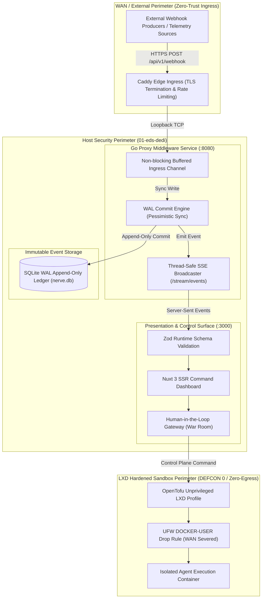
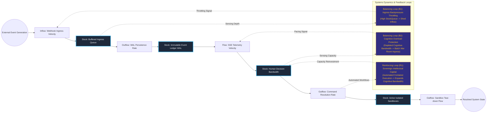

# Decoupled Event-Sourcing Operations Hub & Human-in-the-Loop Gateway

## Executive Summary
This platform decouples high-leverage intellectual decision-making from high-volume mechanical execution via an asynchronous, event-driven command layer. Built around an ultra-lean Go ingestion proxy paired with an append-only SQLite WAL ledger and a real-time Nuxt 3 presentation surface, the architecture eliminates human operational bottlenecks while preserving deterministic auditability. By bridging operational telemetry to unprivileged, zero-egress LXD sandboxes, it achieves enterprise operational leverage without exposing critical infrastructure or internal state to third-party cloud boundaries.

## Core Architectural Paradigms
- **Append-Only Event Sourcing**: Incoming webhooks and state transitions are immutably persisted to a Write-Ahead Log (WAL) SQLite ledger prior to broadcast, guaranteeing crash resilience and zero event loss.
- **Thread-Safe Unicast & Fanout Streaming**: Low-overhead Server-Sent Events (SSE) stream state transitions to frontend operators with sub-millisecond dispatch latency via native Go synchronization primitives.
- **Human-in-the-Loop Gateway**: High-impact execution paths require explicit operator consensus before spawning autonomous execution workers, preventing systemic cascade failure.
- **Zero-Egress Containment (DEFCON 0)**: Provisioned execution workers run within kernel-isolated, unprivileged LXD containers governed by OpenTofu IaC and strict host firewall isolation.

## Systems Architecture Diagram



## Applied Systems Theory: Stocks & Flows Dynamics



## Ephemeral Docker Compilation Command

To compile both `.mmd` diagrams into standalone `.svg` vectors locally without installing Node.js or Mermaid CLI dependencies on the host:

```bash
docker run --rm -v "$(pwd)/projects/01-event-sourcing-operations-hub/diagrams":/data minlag/mermaid-cli -i /data/architecture.mmd -o /data/architecture.svg
docker run --rm -v "$(pwd)/projects/01-event-sourcing-operations-hub/diagrams":/data minlag/mermaid-cli -i /data/stocks-and-flows.mmd -o /data/stocks-and-flows.svg
```
