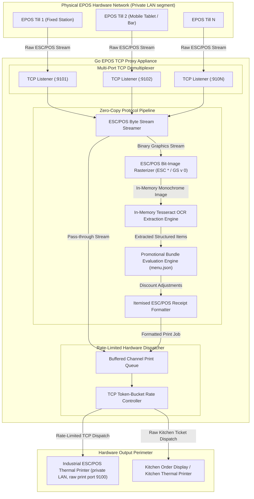
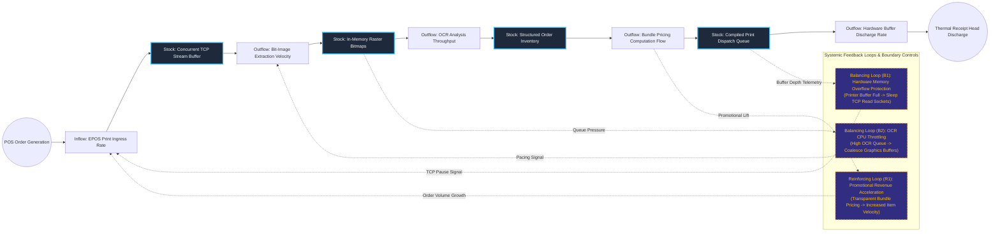

# High-Throughput EPOS TCP Proxy Middleware

## Executive Summary
This enterprise edge proxy intercepts raw ESC/POS binary print streams across multi-till point-of-sale installations to perform zero-latency protocol manipulation and dynamic valuation. By rasterizing raw ESC/POS bit-images in memory and feeding them through an embedded OCR pipeline, the middleware extracts line-item records on the fly, applies promotional bundle pricing, and emits formatted itemized receipts alongside unaltered kitchen orders. This creates high-margin promotional agility for legacy hospitality infrastructure without modifying proprietary point-of-sale firmware or incurring vendor re-certification expenses.

## Core Architectural Paradigms
- **Zero-Copy Byte-Level Demultiplexing**: Implements concurrent non-blocking TCP listeners in Go, multiplexing high-throughput print payloads across concurrent till connections without intermediate disk writes.
- **In-Memory Rasterization & Optical Character Recognition**: Decodes ESC * double-density and GS v 0 raster streams directly into memory-backed monochrome image structures, piping pixel data to an optimized Tesseract OCR engine.
- **Deterministic Token-Bucket Flow Control**: Manages hardware printer memory backpressure via a rate-limited dispatch queue, preventing serial buffer overflows and printer disconnects during peak service rushes.
- **Fail-Open Hardware Pass-Through**: If OCR or bundle rule evaluation fails, the raw original ticket payload is guaranteed pass-through transmission to ensure operational continuity on the restaurant floor.

## Systems Architecture Diagram



## Applied Systems Theory: Stocks & Flows Dynamics



## Ephemeral Docker Compilation Command

To compile both `.mmd` diagrams into standalone `.svg` vectors locally without host dependencies:

```bash
docker run --rm -v "$(pwd)/projects/02-epos-tcp-proxy-middleware/diagrams":/data minlag/mermaid-cli -i /data/architecture.mmd -o /data/architecture.svg
docker run --rm -v "$(pwd)/projects/02-epos-tcp-proxy-middleware/diagrams":/data minlag/mermaid-cli -i /data/stocks-and-flows.mmd -o /data/stocks-and-flows.svg
```
