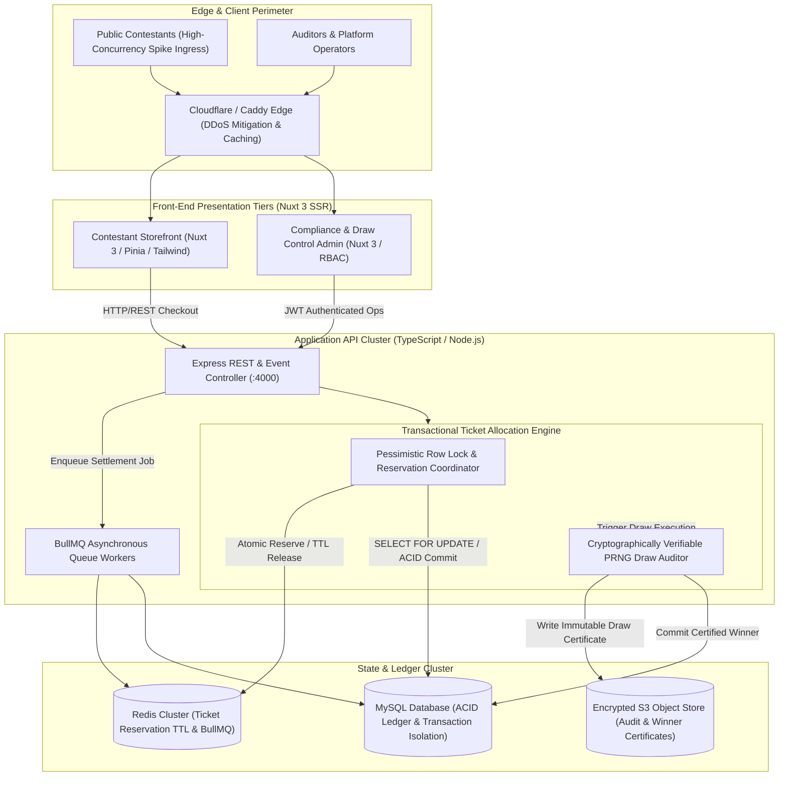
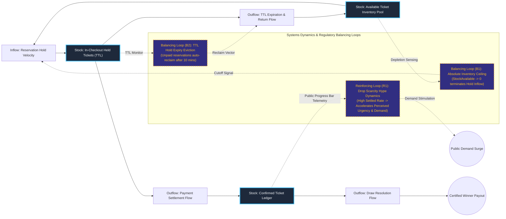

# UK Regulatory-Compliant Competition & Prize Gaming Platform

## Executive Summary
This platform delivers a high-throughput, legally compliant digital prize draw and gaming engine capable of processing intense checkout spikes during flash competition drops. By pairing an optimistic Nuxt 3 presentation layer with a pessimistic transactional locking mechanism and a BullMQ Redis queue, the system eliminates duplicate ticket allocations and prevents race conditions under extreme load. The architecture incorporates cryptographically verifiable Pseudo-Random Number Generation (PRNG) draw execution and immutable audit logging to satisfy stringent UK compliance guidelines.

## Core Architectural Paradigms
- **Pessimistic Inventory Locking**: Uses ACID transactions and atomic Redis key TTL reservations to guarantee zero double-spend or duplicate ticket issuance during concurrent flash sales.
- **Decoupled Asynchronous Order Settlement**: Defers resource-intensive post-checkout processing (ledger updates, transactional emails, webhook distribution) to BullMQ worker pools, keeping edge checkout response times under 50ms.
- **Verifiable PRNG Draw Mechanics**: Generates provably fair draw results through seeded pseudorandom algorithms with immutable draw certificate generation archived directly to S3.
- **Regulatory Audit Trail**: Maintains an append-only transaction history linking contestants, verified identification, payment gateway receipts, and specific ticket IDs.

## Systems Architecture Diagram



## Applied Systems Theory: Stocks & Flows Dynamics



## Ephemeral Docker Compilation Command

To compile both `.mmd` diagrams into standalone `.svg` vectors locally without host dependencies:

```bash
docker run --rm -v "$(pwd)/projects/03-competition-prize-gaming-platform/diagrams":/data minlag/mermaid-cli -i /data/architecture.mmd -o /data/architecture.svg
docker run --rm -v "$(pwd)/projects/03-competition-prize-gaming-platform/diagrams":/data minlag/mermaid-cli -i /data/stocks-and-flows.mmd -o /data/stocks-and-flows.svg
```
