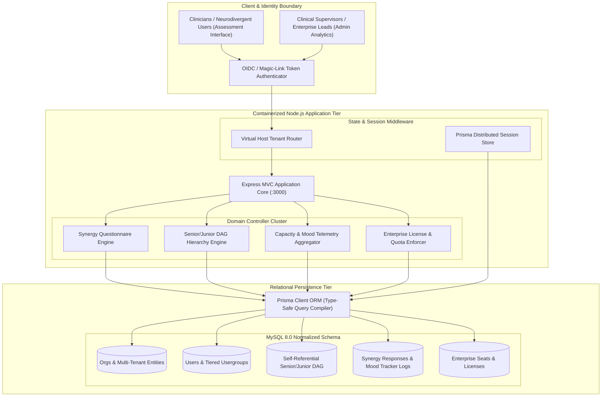
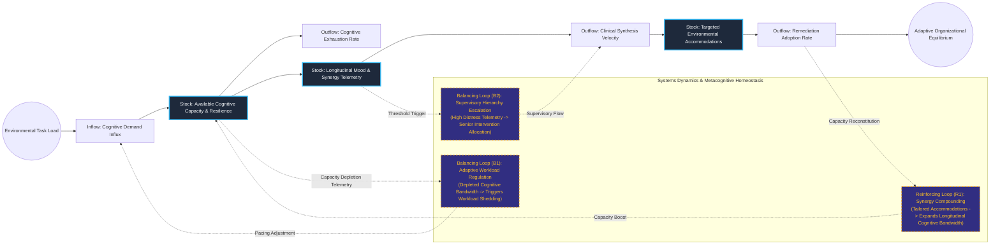

# Neurodevelopmental Cognitive Systems & Capacity Modeling Engine

## Executive Summary
This multidimensional assessment and human capacity modeling platform evaluates cognitive traits, workplace synergy, and longitudinal behavioral telemetry. Leveraging a graph-relational hierarchy in Prisma with tier-based RBAC, it transforms complex psychometric questionnaire telemetry into actionable systemic intervention vectors while strictly enforcing tenant organizational boundaries. The architecture provides clinical supervisors and organizational leadership with real-time feedback loops to mitigate cognitive overload and optimize collaborative output.

## Core Architectural Paradigms
- **Hierarchical Graph Modeling**: Employs a self-referential Senior/Junior relational graph to map organizational reporting structures and clinical supervisory oversight dynamically.
- **Longitudinal Telemetry Aggregation**: Tracks granular, time-series psychometric responses and mood fluctuations, allowing statistical trend modeling and early warning detection of cognitive depletion.
- **Multi-Tenant Schema Segmentation**: Implements virtual host routing coupled with organizational scoping to ensure absolute tenant data sovereignty and compliance with sensitive health data standards.
- **Cryptographic Tokenized Access**: Utilizes single-use magic link authentication tokens and sliding session security to minimize authentication friction for neurodivergent participants.

## Systems Architecture Diagram



## Applied Systems Theory: Stocks & Flows Dynamics



## Ephemeral Docker Compilation Command

To compile both `.mmd` diagrams into standalone `.svg` vectors locally without host dependencies:

```bash
docker run --rm -v "$(pwd)/projects/04-cognitive-capacity-modeling-engine/diagrams":/data minlag/mermaid-cli -i /data/architecture.mmd -o /data/architecture.svg
docker run --rm -v "$(pwd)/projects/04-cognitive-capacity-modeling-engine/diagrams":/data minlag/mermaid-cli -i /data/stocks-and-flows.mmd -o /data/stocks-and-flows.svg
```
