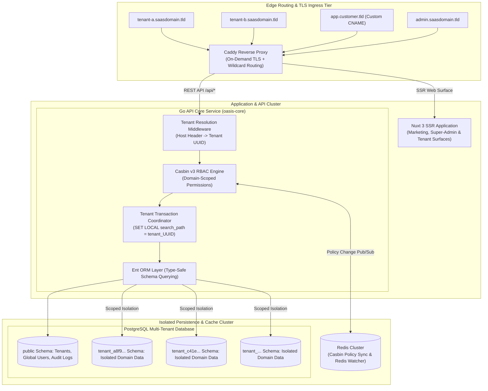
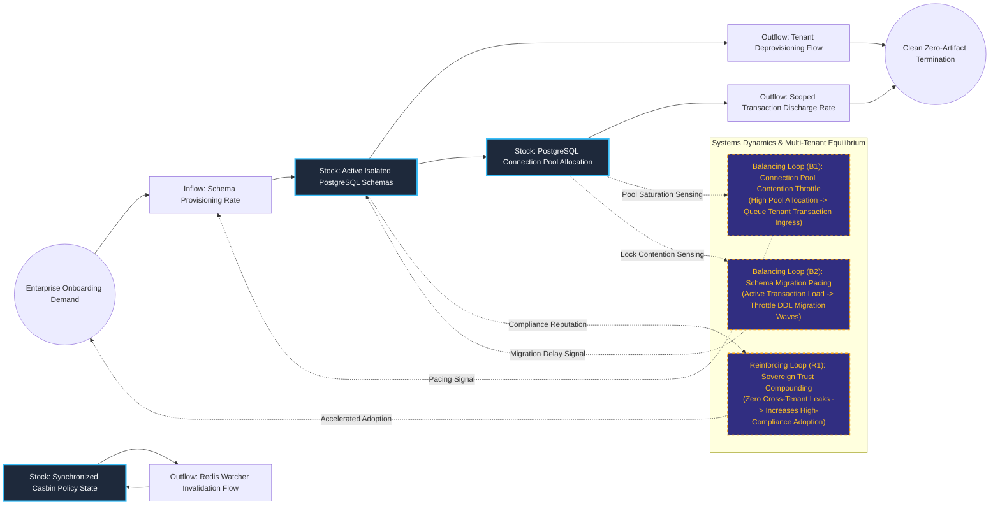

# Schema-Isolated Multi-Tenant Distributed SaaS Foundation (OASIS)

## Executive Summary
OASIS (Opinionated Architecture for Secure Isolated SaaS) provides a high-leverage software foundation that combines the security of isolated multi-tenancy with the developer ergonomics of single-tenant development. By assigning every customer an independent PostgreSQL schema via automatic `SET LOCAL search_path` transaction scoping and managing fine-grained RBAC with Casbin and Redis, the framework physically prevents cross-tenant data contamination. Coupled with dynamic on-demand TLS termination via Caddy and a unified Nuxt 3 presentation engine, it empowers engineering teams to ship enterprise-grade SaaS products with zero architectural compromises on data sovereignty.

## Core Architectural Paradigms
- **Database Schema Isolation**: Enforces physical boundaries at the database layer with one PostgreSQL schema per tenant, rendering cross-tenant data leakage impossible even in the event of application-level SQL logic bugs.
- **Domain-Scoped Casbin RBAC**: Implements unified Role-Based Access Control synchronizing role changes across distributed nodes in real time via a Redis-watcher pub/sub network.
- **Zero-Friction Single-Tenant Developer Model**: Back-end feature code writes standard ORM queries (Ent) without manually appending `tenant_id` WHERE clauses, drastically reducing developer cognitive load and vulnerability surface area.
- **Dynamic On-Demand Edge Ingress**: Caddy orchestrates automated Let's Encrypt TLS certificate generation and routing for unlimited custom customer CNAME hostnames on the fly.

## Systems Architecture Diagram



## Applied Systems Theory: Stocks & Flows Dynamics



## Ephemeral Docker Compilation Command

To compile both `.mmd` diagrams into standalone `.svg` vectors locally without host dependencies:

```bash
docker run --rm -v "$(pwd)/projects/05-schema-isolated-multi-tenant-saas/diagrams":/data minlag/mermaid-cli -i /data/architecture.mmd -o /data/architecture.svg
docker run --rm -v "$(pwd)/projects/05-schema-isolated-multi-tenant-saas/diagrams":/data minlag/mermaid-cli -i /data/stocks-and-flows.mmd -o /data/stocks-and-flows.svg
```
