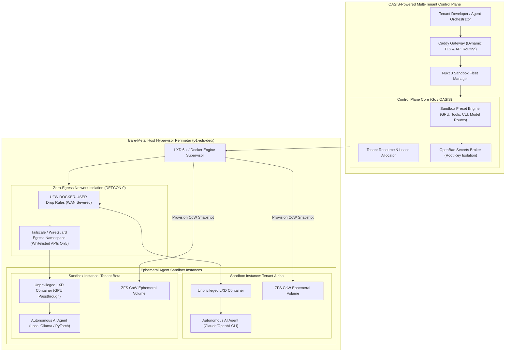
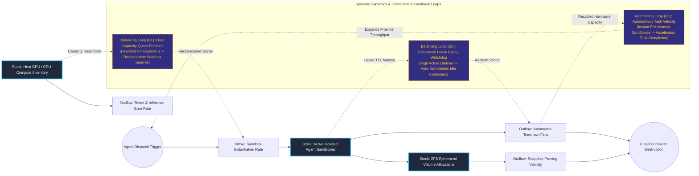

# Autonomous AI Agent Containment & Ephemeral Sandbox Control Plane

## Executive Summary
This enterprise management control plane provides mathematical execution isolation for untrusted autonomous AI agents, script executors, and coding models. Built on top of the OASIS schema-isolated multi-tenant foundation, tenants can dynamically configure, snapshot, and execute unprivileged LXD and Docker workspaces with custom resource limits, GPU passthrough, and model routes. By enforcing a strict DEFCON 0 zero-egress perimeter via host-level UFW DOCKER-USER drop rules and isolated WireGuard/Tailscale network namespaces, the platform guarantees that agentic operations cannot leak proprietary intellectual property or pivot into internal infrastructure networks.

## Core Architectural Paradigms
- **Zero-Egress Containment (DEFCON 0)**: Physically drops all outbound WAN traffic by default at the host kernel packet filter layer, allowing outbound requests only through explicitly whitelisted VPN egress network namespaces.
- **Copy-on-Write (CoW) Ephemeral Storage**: Utilizes ZFS snapshotting to instantiate pre-warmed agent sandboxes in under 2 seconds and reliably demolishes workspace state upon task resolution with zero residual data remnants.
- **Hardware Quota & GPU Passthrough Isolation**: Implements deterministic resource fencing (CPU pinning, RAM cgroups, and isolated NVIDIA GPU slice assignment) preventing runaway agent processes from destabilizing host operations.
- **Decoupled Root Key Secret Brokerage**: Integrates with OpenBao to inject ephemeral, short-lived API credentials into container runtimes without ever writing secret keys to disk or environment variables.

## Systems Architecture Diagram



## Applied Systems Theory: Stocks & Flows Dynamics



## Ephemeral Docker Compilation Command

To compile both `.mmd` diagrams into standalone `.svg` vectors locally without host dependencies:

```bash
docker run --rm -v "$(pwd)/projects/06-autonomous-ai-sandbox-control-plane/diagrams":/data minlag/mermaid-cli -i /data/architecture.mmd -o /data/architecture.svg
docker run --rm -v "$(pwd)/projects/06-autonomous-ai-sandbox-control-plane/diagrams":/data minlag/mermaid-cli -i /data/stocks-and-flows.mmd -o /data/stocks-and-flows.svg
```
