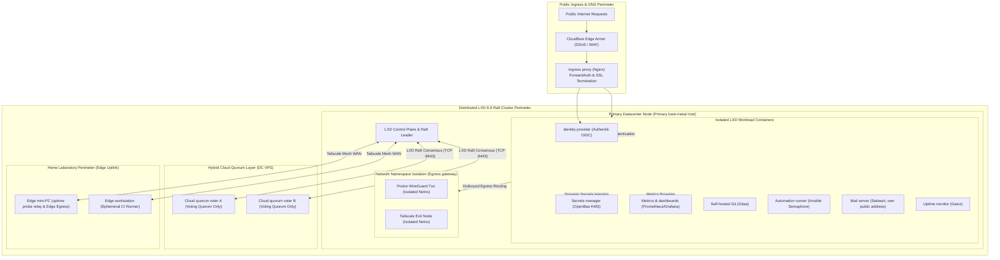
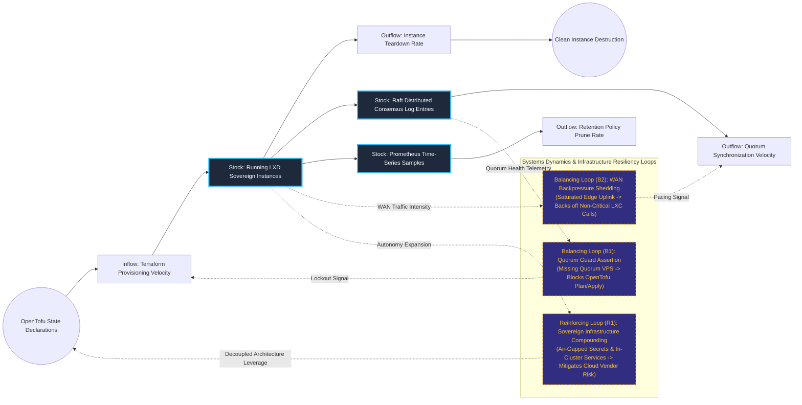

# Sovereign Multi-Node Hybrid-Cloud LXD Cluster & Zero-Trust Engine

## Executive Summary
This hybrid-cloud infrastructure platform anchors a resilient, self-hosted operational footprint across bare-metal dedicated servers, cloud quorum nodes, and physical edge hardware. Orchestrated via OpenTofu and Ansible, the LXD 6.9 cluster enforces strict zero-trust boundaries with central Authentik OIDC authentication, OpenBao secret management, and network-namespace-isolated WireGuard egress tunnels. By maintaining independent data residency and sovereign version control (Gitea) within an audited cluster perimeter, the architecture guarantees absolute control over enterprise IP while maintaining high availability.

## Core Architectural Paradigms
- **Raft Distributed Consensus with Cluster Guard**: Employs an odd-numbered Raft control plane spanning physical datacenter hosts and cloud VPS quorum witnesses, guarded by OpenTofu drift assertions that block execution upon quorum mismatch.
- **Unified Zero-Trust Identity & Secret Management**: Standardizes internal service authentication on Authentik SSO and dynamic programmatic secret injection via OpenBao, eliminating static hardcoded credentials across all instances.
- **Isolated Network Namespace Egress**: Routes outbound internet traffic from sensitive containers through dedicated network namespaces running WireGuard and Tailscale exit tunnels, severing direct WAN address exposure.
- **Telemetry-Driven Self-Observability**: Implements automated Prometheus metric discovery across all LXD nodes, coupled with Gatus distributed multi-vantage heartbeat probes and pre-configured Grafana dashboards.

## Systems Architecture Diagram



## Applied Systems Theory: Stocks & Flows Dynamics



## Ephemeral Docker Compilation Command

To compile both `.mmd` diagrams into standalone `.svg` vectors locally without host dependencies:

```bash
docker run --rm -v "$(pwd)/projects/07-sovereign-hybrid-cloud-lxd-cluster/diagrams":/data minlag/mermaid-cli -i /data/architecture.mmd -o /data/architecture.svg
docker run --rm -v "$(pwd)/projects/07-sovereign-hybrid-cloud-lxd-cluster/diagrams":/data minlag/mermaid-cli -i /data/stocks-and-flows.mmd -o /data/stocks-and-flows.svg
```
