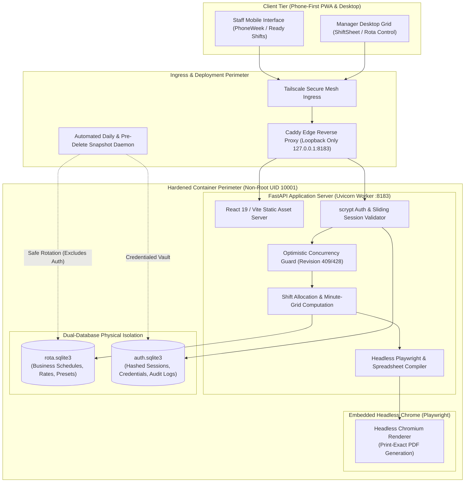
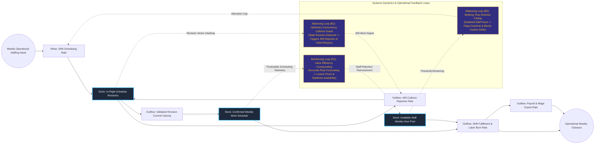

# Enterprise Workforce Scheduling & Optimistic Concurrency Rota Engine

## Executive Summary
This workforce planning and labor allocation system orchestrates shift scheduling across high-turnover hospitality environments with mathematical conflict avoidance. Engineered inside a hardened, unprivileged Docker container running FastAPI and React 19, the architecture enforces an optimistic revision control scheme (HTTP 409 collision prevention) paired with physical dual-database isolation between sensitive authentication credentials and operational rosters. Incorporating headless Chromium for pixel-perfect PDF export and zero-downtime rolling deployments over Tailscale, it eliminates scheduling chaos and payroll drift.

## Core Architectural Paradigms
- **Optimistic Concurrency Control**: Tracks global weekly revision integers, instantly rejecting out-of-order manager edits with HTTP 409 clashes and requiring HTTP 428 preconditions when mutating historical rotas.
- **Physical Dual-Database Segmentation**: Separates business operations (`rota.sqlite3`) from authentication and audit telemetry (`auth.sqlite3`), ensuring routine operational database backups never compromise customer credentials.
- **Continuous 15-Minute Integer Grid**: Models shifts as integer minutes offset from the business start-of-day up to 2880 minutes, natively handling complex overnight shifts without timezone or daylight savings parsing ambiguities.
- **Headless Chromium Document Pipeline**: Embeds an isolated Playwright Chromium instance inside the application container to render pixel-accurate, server-generated print sheets and management PDF exports.

## Systems Architecture Diagram



## Applied Systems Theory: Stocks & Flows Dynamics



## Ephemeral Docker Compilation Command

To compile both `.mmd` diagrams into standalone `.svg` vectors locally without host dependencies:

```bash
docker run --rm -v "$(pwd)/projects/08-enterprise-workforce-scheduling-engine/diagrams":/data minlag/mermaid-cli -i /data/architecture.mmd -o /data/architecture.svg
docker run --rm -v "$(pwd)/projects/08-enterprise-workforce-scheduling-engine/diagrams":/data minlag/mermaid-cli -i /data/stocks-and-flows.mmd -o /data/stocks-and-flows.svg
```
