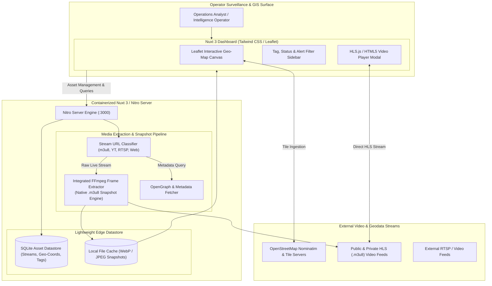
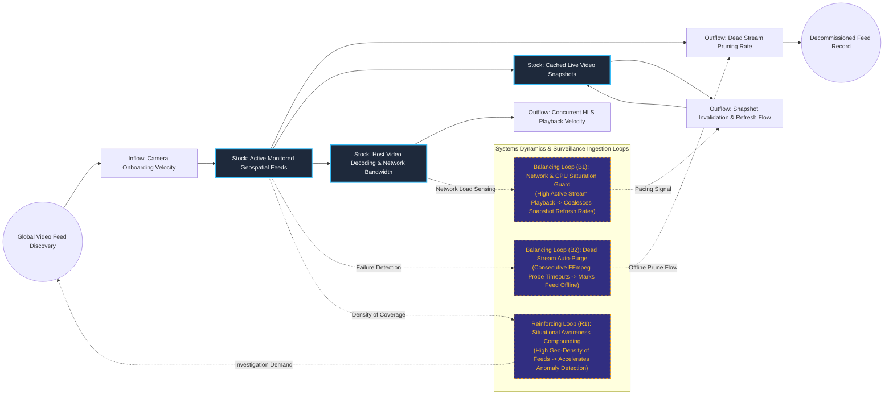

# Geospatial Live Stream Telemetry & Video Asset Intelligence Dashboard

## Executive Summary
This internal geospatial intelligence dashboard correlates real-time video surveillance feeds with interactive geographic coordinate telemetry. Containerized inside an ephemeral Nuxt 3 environment, the platform leverages Leaflet GIS mapping, SQLite persistence, and an integrated headless FFmpeg extraction worker to automatically capture and refresh live `.m3u8` video stream thumbnails without third-party API dependencies. With built-in alert tagging, dark-mode satellite switching, and zero-key local map serving, the architecture delivers rapid situational awareness for remote physical asset monitoring.

## Core Architectural Paradigms
- **Zero-Dependency GIS Mapping**: Integrates Leaflet and OpenStreetMap Nominatim reverse geocoding directly within client bundles, eliminating external map vendor API licensing fees.
- **Embedded FFmpeg Snapshot Engine**: Utilizes background server-side FFmpeg subprocesses to probe raw `.m3u8` HLS feeds on demand, capturing live video frame snapshots without keeping high-bandwidth video pipes permanently open.
- **Dynamic Tag-Based Alert Highlighting**: Employs reactive state filtering to classify cameras as Online, Offline, or IN USE, dynamically rendering animated visual alert perimeters for security-critical coordinates.
- **Self-Contained Ephemeral Appliance**: Packages UI, server-side APIs, database, and media decoding toolchains into a unified Docker Compose footprint with zero host software requirements.

## Systems Architecture Diagram



## Applied Systems Theory: Stocks & Flows Dynamics



## Ephemeral Docker Compilation Command

To compile both `.mmd` diagrams into standalone `.svg` vectors locally without host dependencies:

```bash
docker run --rm -v "$(pwd)/projects/09-geospatial-live-stream-intelligence-dashboard/diagrams":/data minlag/mermaid-cli -i /data/architecture.mmd -o /data/architecture.svg
docker run --rm -v "$(pwd)/projects/09-geospatial-live-stream-intelligence-dashboard/diagrams":/data minlag/mermaid-cli -i /data/stocks-and-flows.mmd -o /data/stocks-and-flows.svg
```
