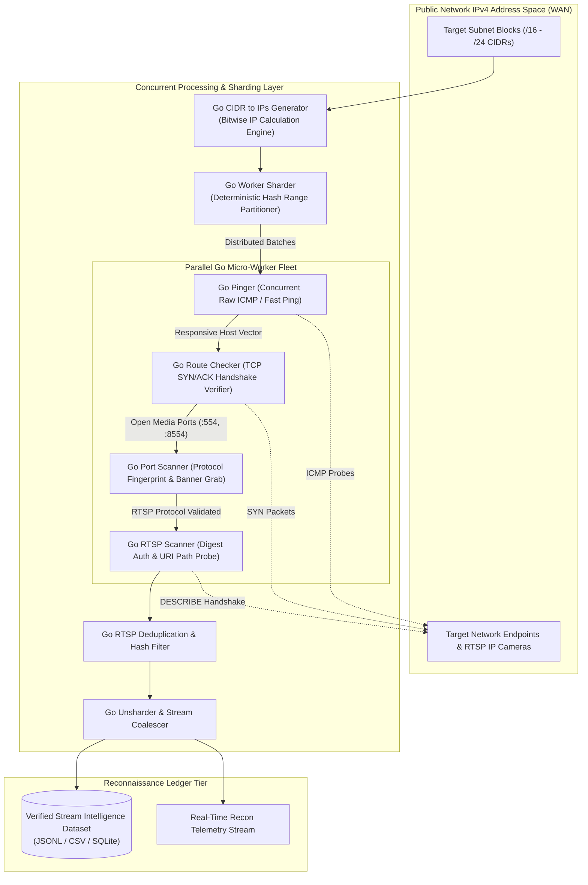
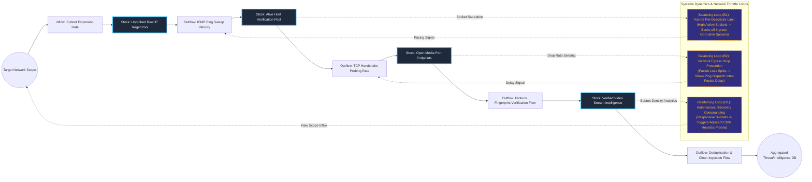

# High-Throughput Network Reconnaissance & RTSP Stream Intelligence Pipeline

## Executive Summary
This distributed open-source intelligence (OSINT) and network reconnaissance pipeline performs mass-scale IP space surveying and real-time RTSP media stream verification. Architected as a modular suite of ultra-fast, concurrent Go micro-utilities, the toolchain decomposes multi-million IP CIDR ranges, performs non-blocking ICMP ping sweeps, validates TCP transport routes, and filters active video streams with automated duplicate removal. The architecture maximizes socket I/O concurrency without triggering network edge saturation or kernel file descriptor exhaustion.

## Core Architectural Paradigms
- **Deterministic Workload Sharding**: Uses lightweight dataset partitioning tools (`Go txt sharder`) to slice astronomical IP scopes into deterministic ranges for parallel execution across distributed compute nodes.
- **Asynchronous Protocol Probing**: Replaces blocking network calls with Goroutine worker pools and non-blocking socket polling, completing sweeps across `/16` subnets in seconds.
- **Multi-Stage Signal Pruning**: Employs a strict pipeline cascade (CIDR Expansion → Fast ICMP Sweep → Route Checking → Banner Verification → RTSP DESCRIBE Handshaking), rejecting inactive targets at the earliest and cheapest network stage.
- **Stream Fingerprinting & Deduplication**: Analyzes stream response digests and frame characteristics to eliminate duplicate feeds originating from the same physical encoder behind multiple NAT addresses.

## Systems Architecture Diagram



## Applied Systems Theory: Stocks & Flows Dynamics



## Ephemeral Docker Compilation Command

To compile both `.mmd` diagrams into standalone `.svg` vectors locally without host dependencies:

```bash
docker run --rm -v "$(pwd)/projects/10-high-throughput-network-recon-pipeline/diagrams":/data minlag/mermaid-cli -i /data/architecture.mmd -o /data/architecture.svg
docker run --rm -v "$(pwd)/projects/10-high-throughput-network-recon-pipeline/diagrams":/data minlag/mermaid-cli -i /data/stocks-and-flows.mmd -o /data/stocks-and-flows.svg
```
