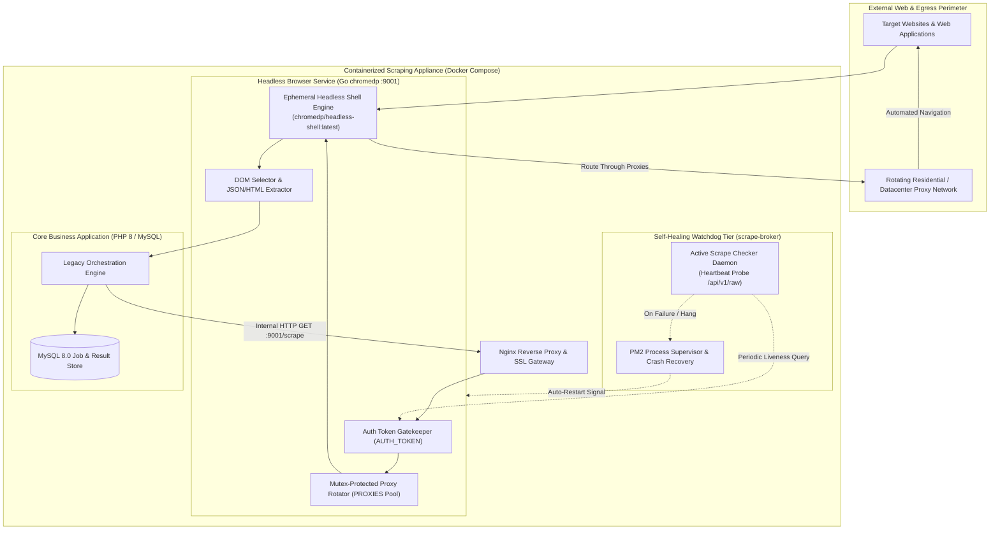
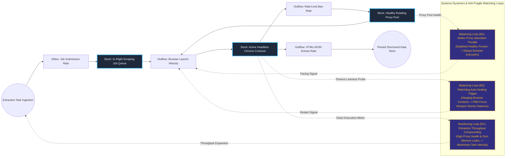

# Containerized Distributed Traffic Exchange & Headless Browser Scraping Cluster

## Executive Summary
This scraping architecture combines legacy application modernization with high-concurrency headless browser automation. Built to handle complex, anti-bot-protected web targets, the system couples a containerized PHP/MySQL foundation with a high-performance Go microservice running headless Chrome (`chromedp`), proxy rotation, and automated DOM extraction. An independent watchdog daemon continuously probes worker liveness, triggering automated process restarts through PM2 upon detecting memory leaks or zombie browser threads.

## Core Architectural Paradigms
- **Headless Browser Microservice Modernization**: Offloads JavaScript execution, cookie extraction, and dynamic DOM rendering to an independent, ephemeral Go service compiled on `chromedp/headless-shell`.
- **Mutex-Protected Proxy Pool Rotation**: Implements thread-safe random proxy selection across distributed IP egress gateways, preventing rate-limiting and IP fingerprint clustering.
- **Per-Request Context Lifecycle**: Destroys browser execution contexts immediately after each scrape request, preventing Chromium zombie processes and eliminating cumulative memory leaks.
- **Autonomous Watchdog Health Recovery**: Employs an external health probe daemon that queries synthetic endpoints, automatically recycling worker processes via PM2 upon detecting deadlocks or hung child processes.

## Systems Architecture Diagram



## Applied Systems Theory: Stocks & Flows Dynamics



## Ephemeral Docker Compilation Command

To compile both `.mmd` diagrams into standalone `.svg` vectors locally without host dependencies:

```bash
docker run --rm -v "$(pwd)/projects/11-distributed-headless-scraping-cluster/diagrams":/data minlag/mermaid-cli -i /data/architecture.mmd -o /data/architecture.svg
docker run --rm -v "$(pwd)/projects/11-distributed-headless-scraping-cluster/diagrams":/data minlag/mermaid-cli -i /data/stocks-and-flows.mmd -o /data/stocks-and-flows.svg
```
