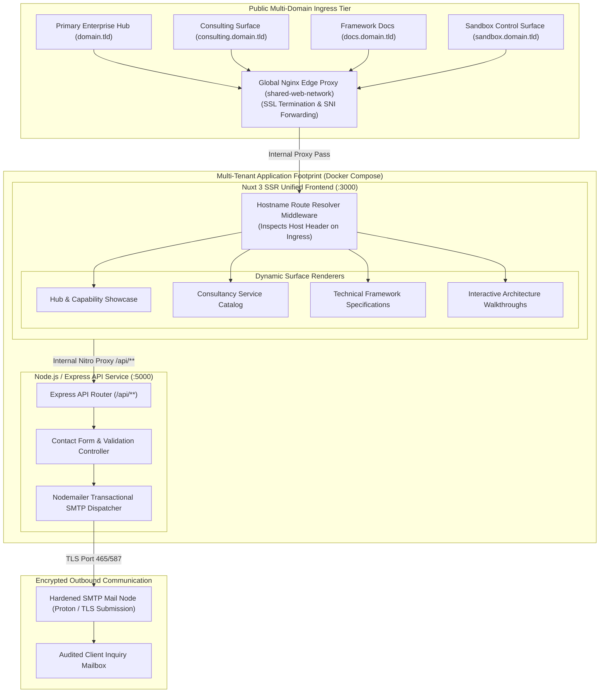
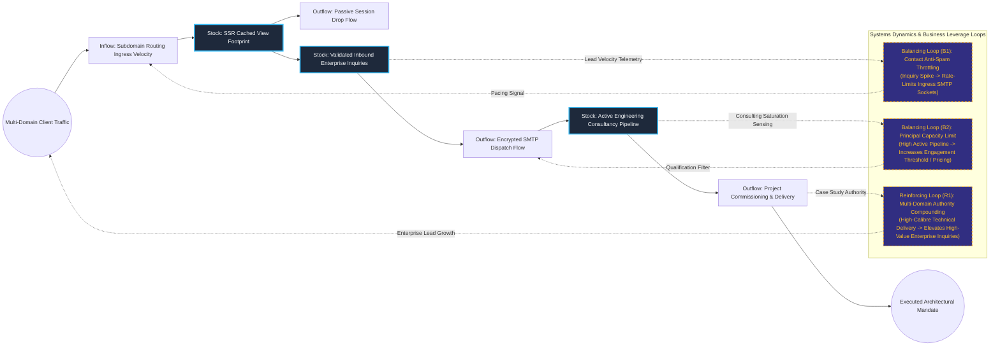

# Unified Multi-Tenant Engineering Consultancy Portal & Dynamic Routing Engine

## Executive Summary
This enterprise corporate portal and technical showcase serves multiple distinct brand domains and product surfaces from a single, unified codebase and containerized footprint. Built with Nuxt 3 (SSR) and an Express API backend, the architecture dynamically inspects incoming HTTP Host headers to render tailored customer experiences—spanning high-level consultancy offerings, architectural framework specifications, and interactive product sandboxes. This approach minimizes operational hosting overhead while providing a cohesive, centralized identity for multi-faceted enterprise advisory engagements.

## Core Architectural Paradigms
- **Dynamic Hostname Inspection & Multi-Domain Dispatch**: Resolves incoming subdomains and apex domains at the server runtime level, rendering distinct layouts and component trees without requiring separate deployments.
- **Unified Containerized Deployment Topology**: Orchestrates frontend presentation and backend API services within an isolated Docker Compose network, fronted by an SSL-terminating Nginx reverse proxy.
- **Secure Asynchronous Form Processing & SMTP Submission**: Routes client inquiry payloads through validation middleware, dispatching encrypted email notifications via dedicated TLS mail relays without exposing internal network endpoints.
- **Server-Side Rendered (SSR) Performance & SEO Optimization**: Combines Vue 3 hydration with edge rendering to guarantee near-instant First Contentful Paint (FCP) and optimal search crawler indexation across all corporate subdomains.

## Systems Architecture Diagram



## Applied Systems Theory: Stocks & Flows Dynamics



## Ephemeral Docker Compilation Command

To compile both `.mmd` diagrams into standalone `.svg` vectors locally without host dependencies:

```bash
docker run --rm -v "$(pwd)/projects/12-unified-multi-tenant-consultancy-routing-portal/diagrams":/data minlag/mermaid-cli -i /data/architecture.mmd -o /data/architecture.svg
docker run --rm -v "$(pwd)/projects/12-unified-multi-tenant-consultancy-routing-portal/diagrams":/data minlag/mermaid-cli -i /data/stocks-and-flows.mmd -o /data/stocks-and-flows.svg
```
