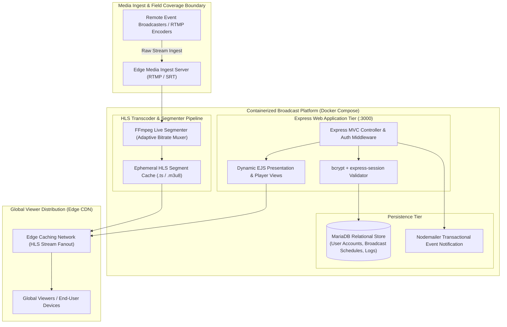
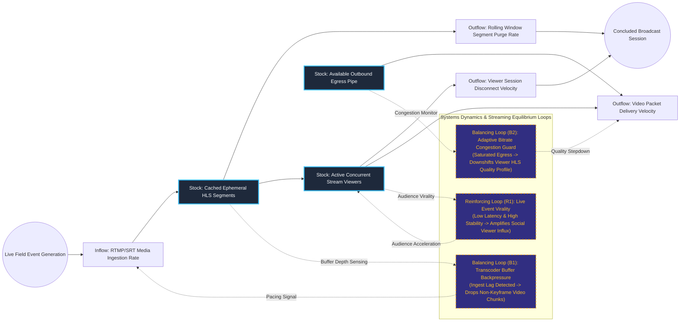

# Low-Latency Global Livestreaming & Event Broadcast Media Platform

## Executive Summary
This media broadcast and livestreaming platform delivers real-time video coverage of live global events to high-concurrency public audiences. Packaged as an autonomous Dockerized appliance, the architecture integrates a high-throughput RTMP/HLS media ingest pipeline, adaptive segment caching, and an Express/MariaDB session and scheduling layer. By leveraging distributed edge CDN caching coupled with rolling-window segment purges, the system ensures sub-three-second broadcast latency without destabilizing host compute or memory buffers.

## Core Architectural Paradigms
- **Adaptive Bitrate HLS Muxing**: Transmuxes incoming RTMP/SRT streams into chunked HTTP Live Streaming (HLS) representations on the fly, adjusting quality profiles dynamically to client network capacity.
- **Rolling Window Ephemeral Storage**: Manages live media segments within an in-memory buffer and ephemeral disk cache, automatically purging expired video chunks to maintain a deterministic disk footprint.
- **Containerized Modular Media Stack**: Decouples the web presentation tier, relational user and schedule database, and video transcoding pipeline into discrete, horizontally scalable Docker containers.
- **Edge-Optimized Fanout Delivery**: Distributes cached video segments through global edge endpoints, protecting the origin application server from viewer flash crowds during breaking live events.

## Systems Architecture Diagram



## Applied Systems Theory: Stocks & Flows Dynamics



## Ephemeral Docker Compilation Command

To compile both `.mmd` diagrams into standalone `.svg` vectors locally without host dependencies:

```bash
docker run --rm -v "$(pwd)/projects/13-low-latency-event-broadcast-platform/diagrams":/data minlag/mermaid-cli -i /data/architecture.mmd -o /data/architecture.svg
docker run --rm -v "$(pwd)/projects/13-low-latency-event-broadcast-platform/diagrams":/data minlag/mermaid-cli -i /data/stocks-and-flows.mmd -o /data/stocks-and-flows.svg
```
