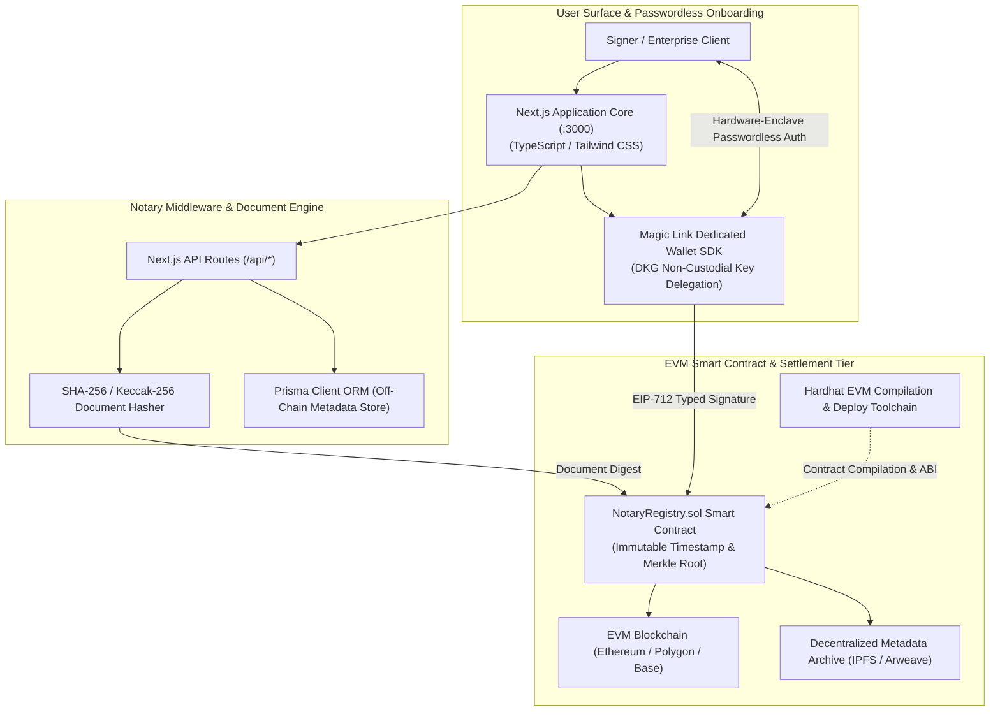
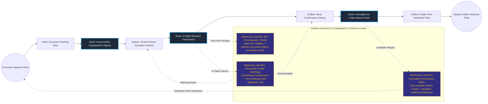

# Decentralized Notary & Passwordless Web3 Authentication Gateway

## Executive Summary
This enterprise digital notary and decentralized identity gateway bridges frictionless Web2 user onboarding with immutable Web3 cryptographic verification. Built on Next.js, Hardhat, and the Magic Link Dedicated Wallet SDK, the architecture allows non-technical enterprise users to digitally timestamp contracts, notarize legal agreements, and verify identity claims on-chain without holding cryptocurrency or managing raw private key seed phrases. Off-chain metadata is orchestrated via Prisma ORM, while on-chain verification leverages gas-optimized Solidity smart contracts.

## Core Architectural Paradigms
- **Non-Custodial Delegated Key Management**: Integrates Magic Link's Distributed Key Generation (DKG) architecture, generating hardware-enclave protected Ethereum keypairs via email/SMS magic links.
- **Gas-Optimized Merkle Root Timestamping**: Batches high-volume document hashes into Merkle trees to anchor cryptographic proofs on EVM blockchains at minimal gas overhead.
- **Decoupled Off-Chain / On-Chain State Boundary**: Preserves zero-knowledge privacy by storing sensitive document metadata within encrypted off-chain stores while committing only irreversible cryptographic hashes to the public ledger.
- **Automated Hardhat Smart Contract Pipeline**: Features deterministic smart contract compilation, static bytecode analysis, and deployment automation with type-safe ABI bindings.

## Systems Architecture Diagram



## Applied Systems Theory: Stocks & Flows Dynamics



## Ephemeral Docker Compilation Command

To compile both `.mmd` diagrams into standalone `.svg` vectors locally without host dependencies:

```bash
docker run --rm -v "$(pwd)/projects/14-decentralized-notary-web3-auth-gateway/diagrams":/data minlag/mermaid-cli -i /data/architecture.mmd -o /data/architecture.svg
docker run --rm -v "$(pwd)/projects/14-decentralized-notary-web3-auth-gateway/diagrams":/data minlag/mermaid-cli -i /data/stocks-and-flows.mmd -o /data/stocks-and-flows.svg
```
