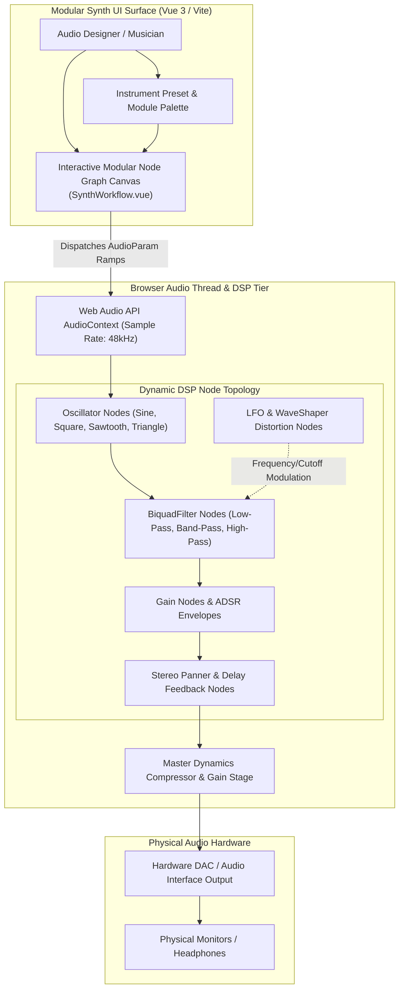
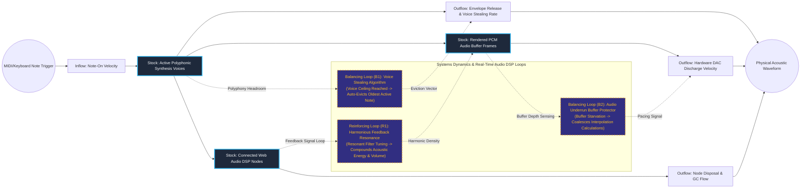

# Web Audio DSP Modular Synthesizer & Node Graph Audio Workstation

## Executive Summary
This interactive web-native digital signal processing (DSP) synthesis workstation executes complex audio graphs directly inside modern browsers. Built with Vue 3 and Vite, the platform orchestrates a modular network of oscillators, state-variable filters, ADSR envelopes, and spatial processors using the hardware-accelerated Web Audio API. By abstracting audio node topology manipulation into a reactive visual node graph, it delivers low-latency musical synthesis and sound design capabilities without requiring proprietary native plugins or DAW software.

## Core Architectural Paradigms
- **Browser-Native DSP Pipeline**: Directly leverages the browser's hardware-accelerated Web Audio API rendering thread, achieving sample-accurate timing and sub-10ms audio latency.
- **Dynamic Node-Graph Topology**: Models audio routing as an extensible directed graph where users can patch arbitrary modulation vectors (LFO to Filter Cutoff, Envelope to Pitch).
- **Automated Polyphonic Voice Allocation**: Implements intelligent voice stealing algorithms to prevent CPU underruns and audio clicks when concurrent polyphony limits are exceeded.
- **Hardware-Decoupled AudioParam Automation**: Uses exponential and linear parameter ramping scheduled ahead on the AudioContext timeline, guaranteeing flutter-free parameter changes independent of main-thread UI rendering jank.

## Systems Architecture Diagram



## Applied Systems Theory: Stocks & Flows Dynamics



## Ephemeral Docker Compilation Command

To compile both `.mmd` diagrams into standalone `.svg` vectors locally without host dependencies:

```bash
docker run --rm -v "$(pwd)/projects/15-web-audio-dsp-modular-synthesizer/diagrams":/data minlag/mermaid-cli -i /data/architecture.mmd -o /data/architecture.svg
docker run --rm -v "$(pwd)/projects/15-web-audio-dsp-modular-synthesizer/diagrams":/data minlag/mermaid-cli -i /data/stocks-and-flows.mmd -o /data/stocks-and-flows.svg
```
