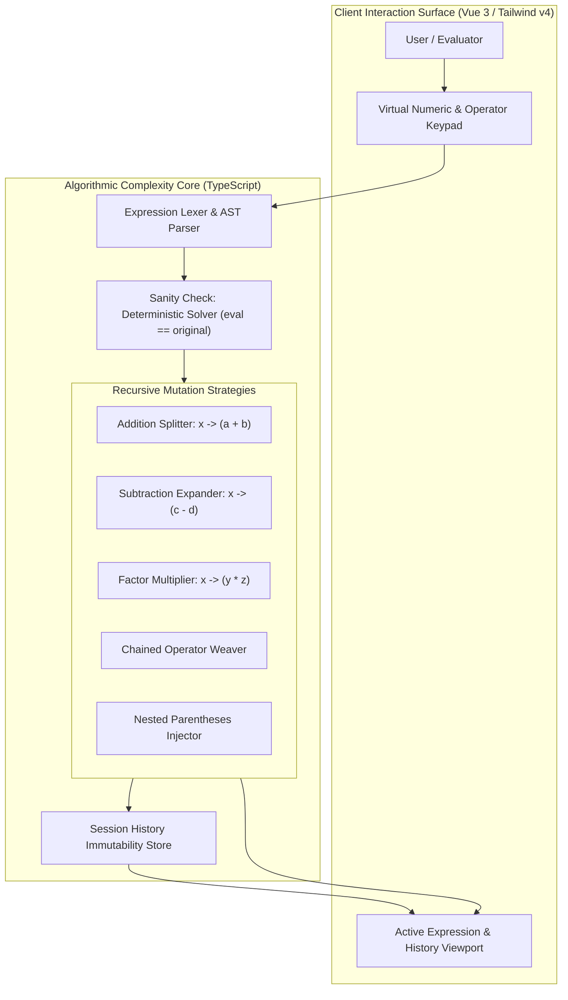
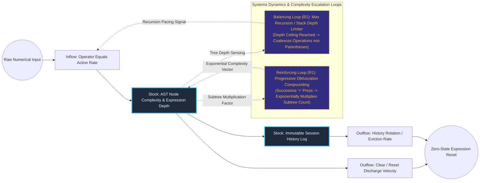

# Algorithmic Expression Deconstruction & Complexity Engine

## Executive Summary
This inverse computation and symbolic expression manipulation engine algorithmically deconstructs arithmetic expressions into recursively complex mathematical equations. Built with Vue 3, TypeScript, and Tailwind CSS v4, the system employs Abstract Syntax Tree (AST) tree expansion and randomized factorization strategies (addition/subtraction splitting, multiplicative factoring, and nested parenthesis injection) to demonstrate progressive complexity generation while verifying mathematical equivalence at each recursive iteration.

## Core Architectural Paradigms
- **Recursive Abstract Syntax Tree Expansion**: Mutates atomic numeric leaves into complex compound subtrees while mathematically preserving the invariant root evaluation.
- **Multiple Deconstruction Strategies**: Dynamically selects between five distinct complication transforms (additive splits, subtractive splits, factor multiplication, chained operations, nested groupings) via weighted probability.
- **Strict Mathematical Invariant Verification**: Runs an internal deterministic algebraic evaluator on every transformed tree before rendering to ensure no calculation drift or rounding artifacts occur.
- **Immutable Session History Graph**: Captures each progressive complication wave into an append-only timeline, allowing instantaneous backtracking and branching exploration.

## Systems Architecture Diagram



## Applied Systems Theory: Stocks & Flows Dynamics



## Ephemeral Docker Compilation Command

To compile both `.mmd` diagrams into standalone `.svg` vectors locally without host dependencies:

```bash
docker run --rm -v "$(pwd)/projects/16-algorithmic-expression-complexity-engine/diagrams":/data minlag/mermaid-cli -i /data/architecture.mmd -o /data/architecture.svg
docker run --rm -v "$(pwd)/projects/16-algorithmic-expression-complexity-engine/diagrams":/data minlag/mermaid-cli -i /data/stocks-and-flows.mmd -o /data/stocks-and-flows.svg
```
