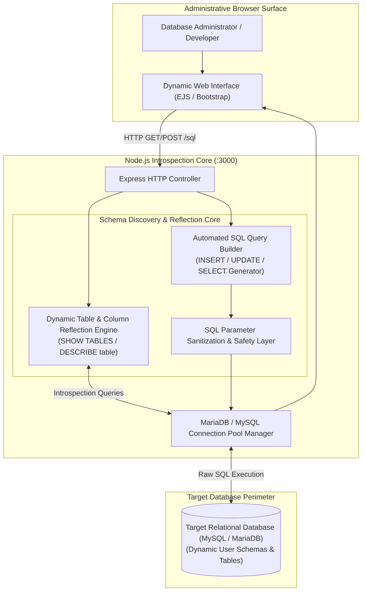
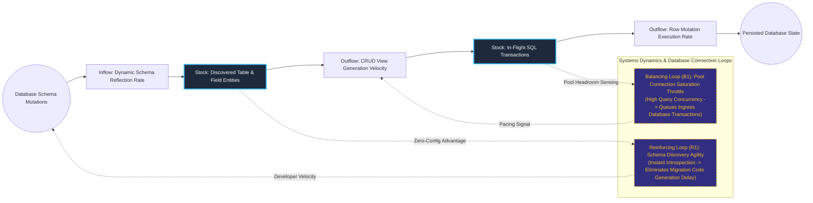

# Lightweight Dynamic Relational Database Introspection & Administration Console

## Executive Summary
This lightweight database administration console dynamically reflects relational database schemas to generate instant data exploration and manipulation surfaces. Built with Node.js, Express, and EJS, the engine interrogates target MySQL/MariaDB instances at request time, parsing live metadata without needing pre-generated models, ORM mappings, or static entity schemas. The platform provides software engineers and systems administrators with rapid data introspection capabilities in resource-constrained edge environments.

## Core Architectural Paradigms
- **Zero-Config Dynamic Schema Reflection**: Discovers database tables, primary keys, and data types on demand via raw metadata queries, eliminating the overhead of ORM code-generation cycles.
- **Automated CRUD Interface Synthesis**: Automatically builds responsive tabular views and row-level edit/insert forms based entirely on reflected database schema constraints.
- **Parameter-Sanitized SQL Execution**: Wraps all generated and custom DML operations in parameterized queries to prevent SQL injection vulnerabilities across dynamic inputs.
- **Minimal Edge Footprint**: Operates with a minimal dependency profile, allowing rapid deployment as an internal sidecar container alongside production databases.

## Systems Architecture Diagram



## Applied Systems Theory: Stocks & Flows Dynamics



## Ephemeral Docker Compilation Command

To compile both `.mmd` diagrams into standalone `.svg` vectors locally without host dependencies:

```bash
docker run --rm -v "$(pwd)/projects/17-dynamic-relational-db-introspection-console/diagrams":/data minlag/mermaid-cli -i /data/architecture.mmd -o /data/architecture.svg
docker run --rm -v "$(pwd)/projects/17-dynamic-relational-db-introspection-console/diagrams":/data minlag/mermaid-cli -i /data/stocks-and-flows.mmd -o /data/stocks-and-flows.svg
```
