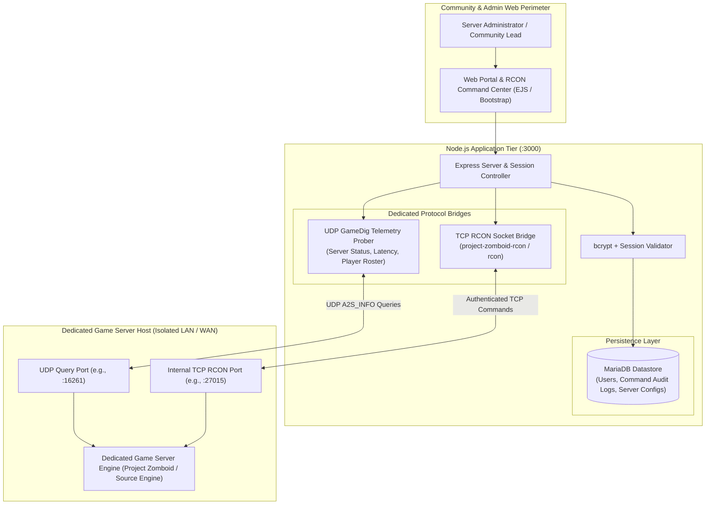
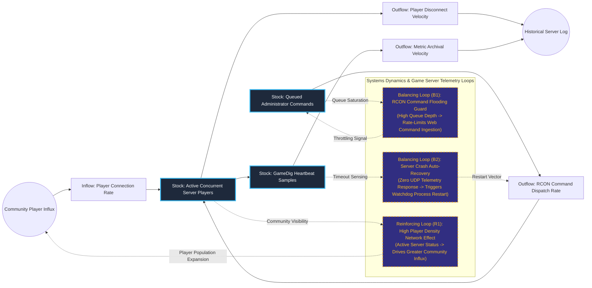

# Dedicated Game Server RCON Orchestrator & Telemetry Gateway

## Executive Summary
This server telemetry and remote administration gateway enables web operators to monitor and orchestrate dedicated multiplayer game servers without exposing raw management ports. Built with Node.js, Express, and MariaDB, the platform pairs asynchronous UDP query probing (GameDig) with an authenticated TCP Remote Console (RCON) protocol bridge. By proxying administrative commands and status metrics through an authenticated web interface, it protects physical game host sockets from port scanning, brute-force attacks, and unauthenticated packet flooding.

## Core Architectural Paradigms
- **Air-Gapped RCON Protocol Bridging**: Intercepts web-based operator commands and converts them to authenticated TCP RCON socket packets, keeping game server management interfaces off public internet interfaces.
- **Asynchronous Game Protocol Telemetry**: Polls server heartbeats, player rosters, and round latency using native UDP query protocols without imposing measurable CPU overhead on the target game engine.
- **Audited Administrative Command Ledger**: Persists all dispatched operator commands, server responses, and timestamped actions to MariaDB to ensure administrative accountability.
- **Hardened Web Control Surface**: Protects web endpoints with bcrypt password hashing, sliding session management, and strict input validation rules.

## Systems Architecture Diagram



## Applied Systems Theory: Stocks & Flows Dynamics



## Ephemeral Docker Compilation Command

To compile both `.mmd` diagrams into standalone `.svg` vectors locally without host dependencies:

```bash
docker run --rm -v "$(pwd)/projects/18-dedicated-game-server-rcon-orchestrator/diagrams":/data minlag/mermaid-cli -i /data/architecture.mmd -o /data/architecture.svg
docker run --rm -v "$(pwd)/projects/18-dedicated-game-server-rcon-orchestrator/diagrams":/data minlag/mermaid-cli -i /data/stocks-and-flows.mmd -o /data/stocks-and-flows.svg
```
