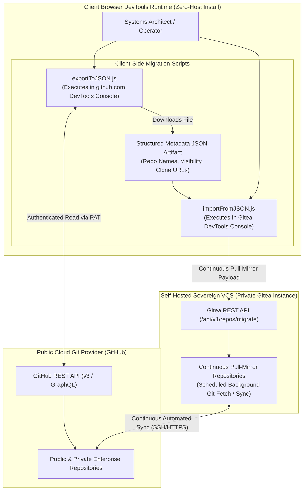
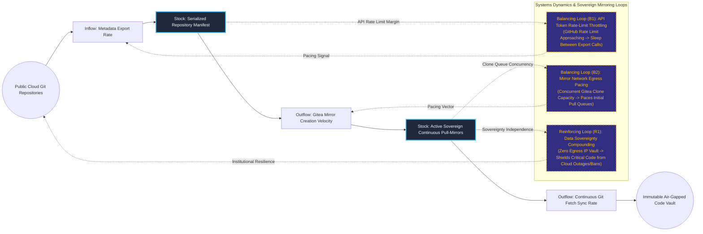

# Sovereign Git Synchronization & Continuous Mirroring Automation

## Executive Summary
This zero-dependency code sovereignty engine automates the batch extraction of public cloud source repositories and establishes continuous, automated pull-mirrors on a private, self-hosted Gitea infrastructure. Designed to run directly within browser developer consoles without requiring local runtime installations (Node.js, Python, or shell tools), the workflow exports complete repository manifests, configures upstream authentication tokens, and orchestrates background git sync daemons. This guarantees complete intellectual property sovereignty and immunity from upstream SaaS outages or provider account revocations.

## Core Architectural Paradigms
- **Zero-Dependency DevTools Execution**: Runs completely inside browser JavaScript runtimes, bypassing local OS package installation hurdles and avoiding credential leakage to local scratch files.
- **Continuous Pull-Mirror Architecture**: Leverages Gitea's native background worker daemon to poll upstream repositories continuously, ensuring private mirrors stay in lockstep with live code commits.
- **Least-Privilege Token Scoping**: Utilizes granular fine-grained GitHub access tokens strictly scoped to read-only metadata and contents, minimizing exposure risk.
- **Resilient Batch Rate-Limit Handling**: Automatically monitors API quota headers, inserting dynamic backoff intervals between requests to prevent API rate-limit lockouts during multi-hundred-repository migrations.

## Systems Architecture Diagram



## Applied Systems Theory: Stocks & Flows Dynamics



## Ephemeral Docker Compilation Command

To compile both `.mmd` diagrams into standalone `.svg` vectors locally without host dependencies:

```bash
docker run --rm -v "$(pwd)/projects/19-sovereign-git-continuous-mirror-automation/diagrams":/data minlag/mermaid-cli -i /data/architecture.mmd -o /data/architecture.svg
docker run --rm -v "$(pwd)/projects/19-sovereign-git-continuous-mirror-automation/diagrams":/data minlag/mermaid-cli -i /data/stocks-and-flows.mmd -o /data/stocks-and-flows.svg
```
