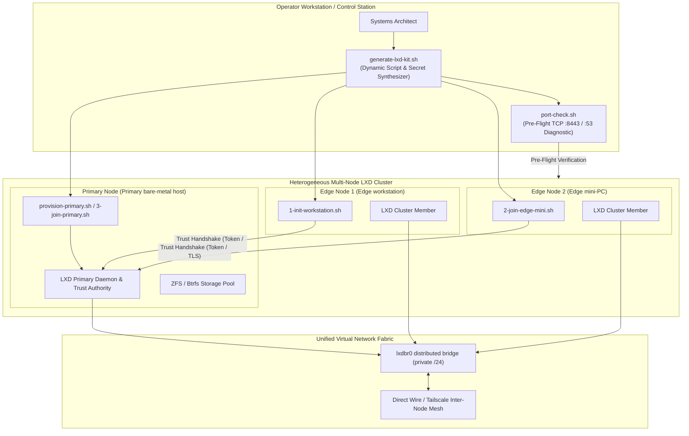
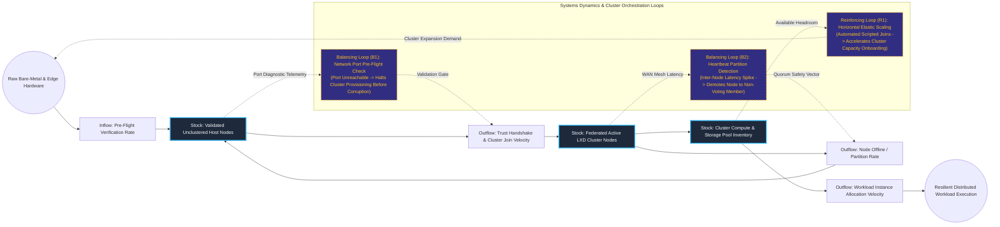

# Automated Multi-Node LXD Clustering & Provisioning Toolkit

## Executive Summary
This infrastructure bootstrapping toolkit automates the discovery, network pre-flight verification, and federation of heterogeneous physical and cloud hardware into a resilient LXD compute cluster. By synthesizing customized join scripts, ephemeral trust tokens, and network bridge definitions, the toolkit enables systems administrators to scale containerized bare-metal clusters across varying network topologies (local Ethernet, Wi-Fi uplinks, and WireGuard overlays) with zero manual certificate copying or configuration drift.

## Core Architectural Paradigms
- **Deterministic Pre-Flight Network Validation**: Runs port connectivity checks across clustering sockets (TCP :8443, DNS, and bridge interfaces) prior to running mutations, preventing half-joined cluster splits.
- **Dynamic Join-Script Synthesis**: Generates targeted, node-specific bootstrap scripts embedding pre-shared cluster tokens and trust fingerprints for zero-touch node onboarding.
- **Unified Virtual Bridge Orchestration**: Automatically configures and standardizes the `lxdbr0` software bridge and firewall forwarding rules across all nodes to provide transparent cross-node container networking.
- **Heterogeneous Hardware Federation**: Unifies distinct hardware classes (workstations, Intel NUC edge nodes, and high-performance bare-metal dedicated servers) under a single management plane.

## Systems Architecture Diagram



## Applied Systems Theory: Stocks & Flows Dynamics



## Ephemeral Docker Compilation Command

To compile both `.mmd` diagrams into standalone `.svg` vectors locally without host dependencies:

```bash
docker run --rm -v "$(pwd)/projects/20-automated-lxd-clustering-provisioning-toolkit/diagrams":/data minlag/mermaid-cli -i /data/architecture.mmd -o /data/architecture.svg
docker run --rm -v "$(pwd)/projects/20-automated-lxd-clustering-provisioning-toolkit/diagrams":/data minlag/mermaid-cli -i /data/stocks-and-flows.mmd -o /data/stocks-and-flows.svg
```
