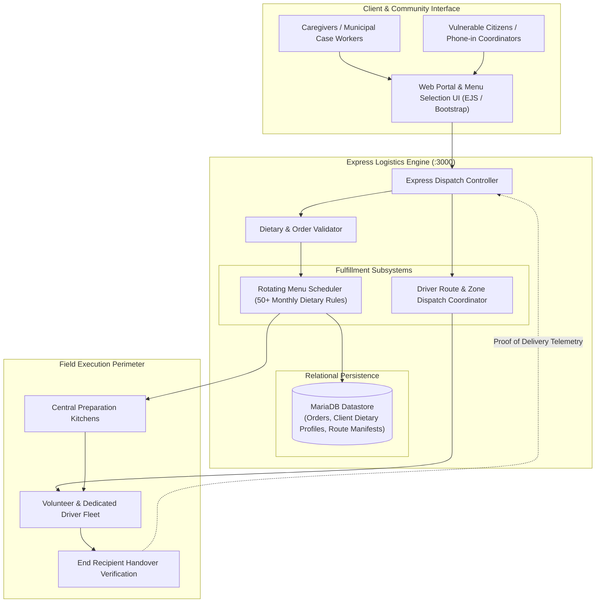
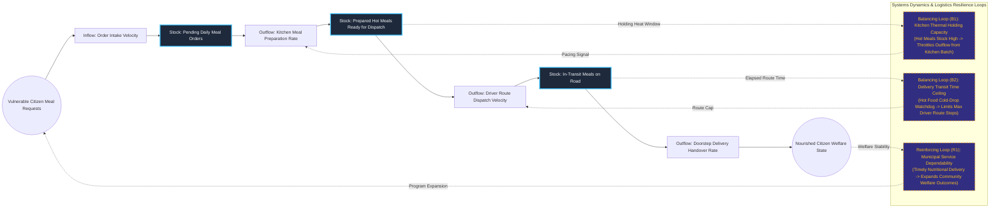

# Nutritional Logistics & Assisted Meal Delivery Platform

## Executive Summary
This municipal logistics and meal delivery platform coordinates hot food distribution and nutritional fulfillment for vulnerable, elderly, and mobility-impaired residents. Developed using Node.js, Express, EJS, and MariaDB, the platform schedules complex recurring dietary matrices (offering over 50 monthly meal variations and multi-option daily menus), verifies dietary restrictions, and organizes driver dispatch routes. By structuring the handover lifecycle into auditable state transitions, the system ensures timely social care delivery across distributed urban catchments.

## Core Architectural Paradigms
- **Complex Dietary Matrix Scheduling**: Supports dynamic rotating menus and individual allergen exclusions, matching recipient medical requirements against daily kitchen batch outputs.
- **Route-Constrained Delivery Dispatches**: Clusters delivery addresses into geographically constrained route manifests to ensure hot meals arrive within strict thermal holding windows.
- **Lightweight Low-Bandwidth Interface**: Built with server-side rendered EJS templates to ensure rapid loading on low-power mobile devices used by volunteer drivers in the field.
- **Auditable Care Verification**: Maintains historical delivery ledgers and recipient contact notes to support social care compliance audits and safeguarding oversight.

## Systems Architecture Diagram



## Applied Systems Theory: Stocks & Flows Dynamics



## Ephemeral Docker Compilation Command

To compile both `.mmd` diagrams into standalone `.svg` vectors locally without host dependencies:

```bash
docker run --rm -v "$(pwd)/projects/21-nutritional-logistics-assisted-delivery-platform/diagrams":/data minlag/mermaid-cli -i /data/architecture.mmd -o /data/architecture.svg
docker run --rm -v "$(pwd)/projects/21-nutritional-logistics-assisted-delivery-platform/diagrams":/data minlag/mermaid-cli -i /data/stocks-and-flows.mmd -o /data/stocks-and-flows.svg
```
