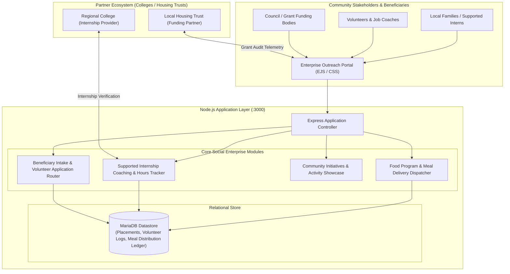
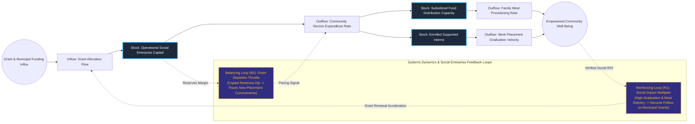

# Non-Profit Community Social Enterprise & Outreach Distribution Portal

## Executive Summary
This community operations and public advocacy platform coordinates subsidized food relief, supported internships, and volunteer engagement for a regional Community Interest Company (CIC). Engineered with Node.js, Express, and MariaDB, the system provides transparent tracking across grant-funded meal delivery programs (distributing hundreds of tailored meals to vulnerable families) and structured employment coaching for supported interns. By providing verifiable audit trails of community outcomes, the portal enables sustainable self-funding and institutional stakeholder alignment.

## Core Architectural Paradigms
- **Outcome-Driven Resource Ledgering**: Tracks meal allocations, coaching hours, and community placement completions against specific grant envelopes, satisfying statutory CIC reporting requirements.
- **Multi-Stakeholder Portal Navigation**: Integrates distinct workflow surfaces for volunteers, partner educational institutions, municipal grant managers, and program beneficiaries.
- **Zero-Friction In-House Hosting**: Deployed on low-overhead containerized infrastructure to minimize non-profit hosting expenditures and guarantee local data sovereignty.
- **Scalable Program Diversification**: Structured modular controllers allow rapid onboarding of new social enterprise initiatives (e.g., day care services, catering ventures) without codebase refactoring.

## Systems Architecture Diagram



## Applied Systems Theory: Stocks & Flows Dynamics



## Ephemeral Docker Compilation Command

To compile both `.mmd` diagrams into standalone `.svg` vectors locally without host dependencies:

```bash
docker run --rm -v "$(pwd)/projects/22-non-profit-community-social-enterprise-portal/diagrams":/data minlag/mermaid-cli -i /data/architecture.mmd -o /data/architecture.svg
docker run --rm -v "$(pwd)/projects/22-non-profit-community-social-enterprise-portal/diagrams":/data minlag/mermaid-cli -i /data/stocks-and-flows.mmd -o /data/stocks-and-flows.svg
```
