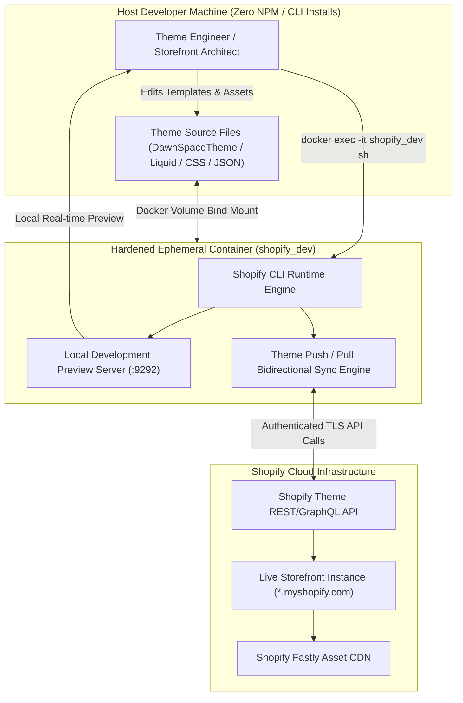
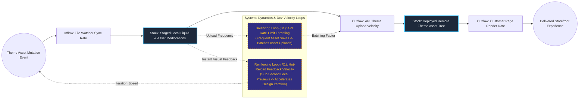

# Containerized E-Commerce Storefront & Design System Engine

## Executive Summary
This enterprise e-commerce development environment and design system orchestrates modern Shopify theme development within a zero-dependency containerized sandbox. Built around an isolated Dockerized toolchain running the Shopify CLI, the architecture allows developers to build, preview, and synchronize bespoke Liquid templates, CSS frameworks, and dynamic section schemas without installing Node.js, Ruby, or global package managers on the host workstation.

## Core Architectural Paradigms
- **Host-Isolated CLI Toolchain**: Encapsulates Shopify CLI and local preview server toolchains within an ephemeral Docker container, eliminating environment version conflicts across developer machines.
- **Bi-Directional Remote Synchronization**: Manages live theme asset pushes and pulls via authenticated Shopify Admin APIs, keeping local version-controlled files in continuous parity with remote stores.
- **Zero-Latency Hot Previewing**: Forwards local development ports (`:9292`) through Docker socket bindings, rendering real-time storefront changes against live store products without impacting production customer sessions.
- **Modular Liquid Component System**: Structures UI components into reusable, atomic Liquid snippets and section schemas for rapid brand adaptation.

## Systems Architecture Diagram



## Applied Systems Theory: Stocks & Flows Dynamics



## Ephemeral Docker Compilation Command

To compile both `.mmd` diagrams into standalone `.svg` vectors locally without host dependencies:

```bash
docker run --rm -v "$(pwd)/projects/23-containerized-ecommerce-design-system/diagrams":/data minlag/mermaid-cli -i /data/architecture.mmd -o /data/architecture.svg
docker run --rm -v "$(pwd)/projects/23-containerized-ecommerce-design-system/diagrams":/data minlag/mermaid-cli -i /data/stocks-and-flows.mmd -o /data/stocks-and-flows.svg
```
