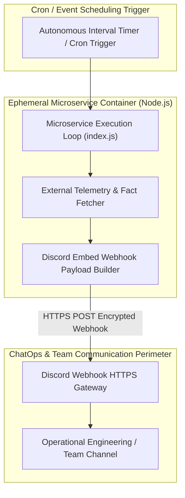

# Automated ChatOps Telemetry & Webhook Broadcast Microservice

## Executive Summary
This autonomous event-driven microservice delivers scheduled telemetry alerts and curated informational broadcasts directly into team ChatOps channels. Built on an ultra-lean Node.js runtime and packaged within an ephemeral Docker container, the service fetches external data payloads, compiles structured Discord webhook embeds, and manages network retry backoffs to provide ambient operational visibility with zero manual operator intervention.

## Core Architectural Paradigms
- **Self-Contained Microservice Footprint**: Packages execution logic, dependencies, and environment configuration inside an ultra-minimal container footprint consuming under 30MB of RAM.
- **Structured ChatOps Embed Formatting**: Compiles rich metadata payloads with contextual color coding and timestamp headers to optimize message readability for engineers.
- **Automated HTTP 429 Exponential Backoff**: Implements rate-limit detection to gracefully pace outbound webhook deliveries without dropping scheduled payloads.
- **Ephemeral State Lifecycle**: Operates statelessly, executing scheduled broadcast intervals without persistent disk state dependencies.

## Systems Architecture Diagram



## Applied Systems Theory: Stocks & Flows Dynamics

```mermaid
flowchart LR
    classDef stock fill:#1e293b,stroke:#38bdf8,stroke-width:3px,color:#f8fafc;
    classDef flow fill:#0f172a,stroke:#a855f7,stroke-width:2px,color:#f8fafc;
    classDef loop fill:#312e81,stroke:#f59e0b,stroke-width:2px,stroke-dasharray: 5 5,color:#fbbf24;

    SourceTrigger((Interval Trigger Event))
    InflowTrigger[Inflow: Scheduled Ingestion Rate]
    StockQueued[Stock: Queued Telemetry Messages]:::stock
    OutflowDispatch[Outflow: Webhook POST Dispatch Rate]

    StockDelivered[Stock: Published Channel Notifications]:::stock
    OutflowRead[Outflow: Team Attention & Review Rate]

    SinkArchived((Acknowledged Operational Notification))

    SourceTrigger --> InflowTrigger
    InflowTrigger --> StockQueued
    StockQueued --> OutflowDispatch
    OutflowDispatch --> StockDelivered
    StockDelivered --> OutflowRead
    OutflowRead --> SinkArchived

    subgraph Loops["Systems Dynamics & Rate-Limit Loops"]
        LoopB1["Balancing Loop (B1): Discord Rate-Limit Backoff\n(HTTP 429 Detected -> Inserts Exponential Retry Backoff)"]:::loop
        LoopR1["Reinforcing Loop (R1): Team Engagement Loop\n(Consistent Ambient Telemetry -> Improves Operational Vigilance)"]:::loop
    end

    StockQueued -.->|Webhook Density Sensing| LoopB1
    LoopB1 -.->|Pacing Signal| OutflowDispatch

    StockDelivered -.->|Operational Visibility| LoopR1
    LoopR1 -.->|Vigilance Vector| OutflowRead
```



## Ephemeral Docker Compilation Command

To compile both `.mmd` diagrams into standalone `.svg` vectors locally without host dependencies:

```bash
docker run --rm -v "$(pwd)/projects/24-automated-chatops-telemetry-microservice/diagrams":/data minlag/mermaid-cli -i /data/architecture.mmd -o /data/architecture.svg
docker run --rm -v "$(pwd)/projects/24-automated-chatops-telemetry-microservice/diagrams":/data minlag/mermaid-cli -i /data/stocks-and-flows.mmd -o /data/stocks-and-flows.svg
```
