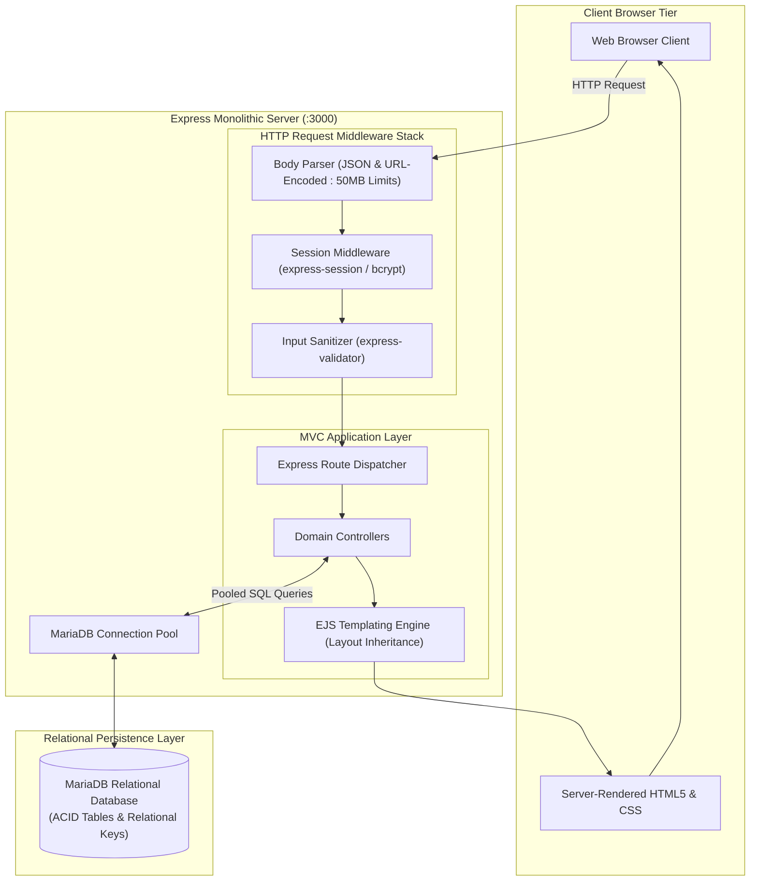
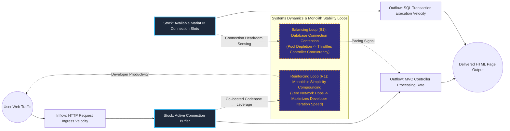

# Monolithic Relational Full-Stack Scaffold (MEEN Architecture)

## Executive Summary
This architectural scaffold provides a battle-tested, monolithic foundation for database-driven web applications and operational tools. Utilizing the MEEN stack (MariaDB, Express, EJS, and Node.js), the template enforces robust request middleware pipelines, connection-pooled SQL execution, server-side template layout inheritance, and strict session isolation. By prioritizing architectural simplicity and single-binary containerization, it enables rapid deployment without distributed network latency or microservice coordination overhead.

## Core Architectural Paradigms
- **Monolithic Simplicity & Low Operational Latency**: Co-locates routing, business logic, templating, and database access within a unified process, eliminating inter-service network hops.
- **Pooled Relational Database Concurrency**: Manages MySQL/MariaDB connections using an asynchronous pool with automatic reconnection and leak detection.
- **Modular MVC Layout Inheritance**: Employs EJS view composition with reusable partials and master layout containers, accelerating user interface prototyping.
- **Defensive Input Sanitization**: Pre-validates incoming request bodies via `express-validator` and enforces strict 50MB payload limits to protect backend memory buffers.

## Systems Architecture Diagram



## Applied Systems Theory: Stocks & Flows Dynamics



## Ephemeral Docker Compilation Command

To compile both `.mmd` diagrams into standalone `.svg` vectors locally without host dependencies:

```bash
docker run --rm -v "$(pwd)/projects/25-monolithic-relational-fullstack-scaffold/diagrams":/data minlag/mermaid-cli -i /data/architecture.mmd -o /data/architecture.svg
docker run --rm -v "$(pwd)/projects/25-monolithic-relational-fullstack-scaffold/diagrams":/data minlag/mermaid-cli -i /data/stocks-and-flows.mmd -o /data/stocks-and-flows.svg
```
