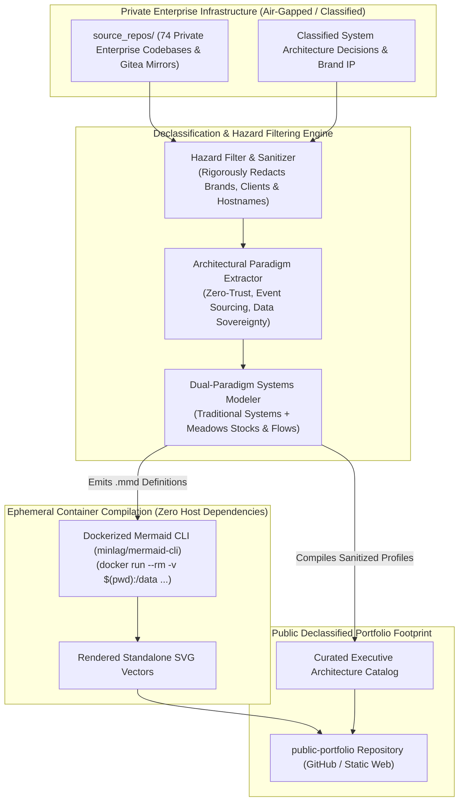
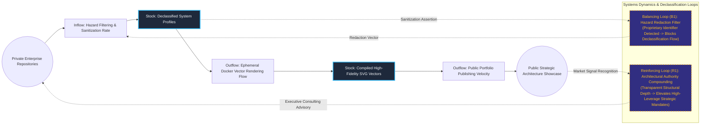

# Principal Systems Engineering Advisory & Public Portfolio Engine

## Executive Summary
This declassified architectural portfolio and engineering capability engine compiles proprietary enterprise codebases into sanitized, publicly auditable systems documentation. Employing dual-paradigm visualization—traditional network/container topology paired with Donella Meadows' Stocks & Flows dynamics—the engine extracts structural engineering principles while stripping all sensitive client branding and operational identifiers. Using throw-away ephemeral Docker compilation toolchains, it produces reproducible SVG architecture blueprints without requiring local host dependencies.

## Core Architectural Paradigms
- **Absolute Brand Sanitization (Hazard Filtering)**: Strips proprietary identifiers, commercial trademarks, customer names, and internal IP to publish safe, high-level architectural references.
- **Dual-Paradigm Systems Visualization**: Bridges traditional network/container topology with Donella Meadows' systems dynamics (Stocks, Inflows, Outflows, and Balancing/Reinforcing Feedback Loops).
- **Ephemeral Containerized Diagram Compilation**: Generates visual SVG documentation via throw-away Docker containers (`minlag/mermaid-cli`), guaranteeing 100% reproducibility across environments with zero host NPM baggage.
- **Data Sovereignty & Zero-Egress Demonstration**: Highlights architectural patterns that protect intellectual property through localized execution, kernel isolation, and event-sourced persistence.

## Systems Architecture Diagram



## Applied Systems Theory: Stocks & Flows Dynamics



## Ephemeral Docker Compilation Command

To compile both `.mmd` diagrams into standalone `.svg` vectors locally without host dependencies:

```bash
docker run --rm -v "$(pwd)/projects/26-principal-systems-engineering-portfolio/diagrams":/data minlag/mermaid-cli -i /data/architecture.mmd -o /data/architecture.svg
docker run --rm -v "$(pwd)/projects/26-principal-systems-engineering-portfolio/diagrams":/data minlag/mermaid-cli -i /data/stocks-and-flows.mmd -o /data/stocks-and-flows.svg
```
